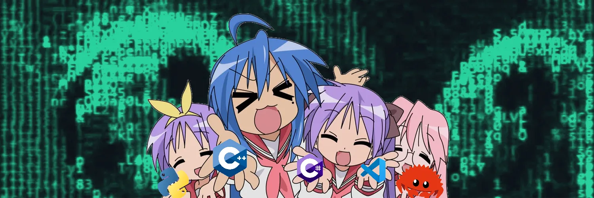
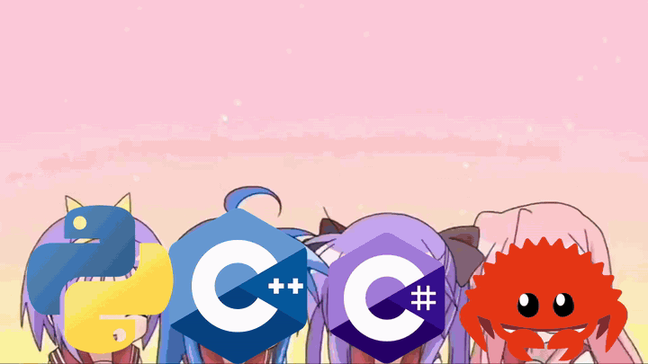

 

Разработчик. Люблю автоматизировать рутину и собирать инструменты, которыми реально пользуюсь сам: ИИ-ассистенты, десктоп-приложения под Windows, расширения для браузера и Aseprite. В профиле **23 репозитория**, часть из них приватные.

- 🤖 **ИИ и автоматизация**: голосовые ассистенты, нейросети (локальные и облачные), автоответы и автопостинг
- 🖥 **Десктоп**: Python и C#, лёгкие утилиты под Windows
- 🧩 **Расширения**: для браузера (Chrome / Firefox) и для Aseprite на Lua
- ⚙️ **C++**: приватные проекты
- 🎮 **Игровые тулзы**: автокликеры, бинды, таймеры
- 😄 Факт: **Git** и **GitHub** это не одно и то же, но неразлучны

 

**Языки**

**Инструменты**

> 🦀 Rust: изучаю.

 

| Проект | Что это | Язык |
|---|---|---|
| [**AIAT**](https://github.com/alalal68-wq/AIAT) | ИИ-ассистент с озвучкой Silero TTS, локальные и облачные нейросети, полная настройка интерфейса |  |
| [**fpauto**](https://github.com/alalal68-wq/fpauto) | Десктоп-приложение для автоматизации лотов на FunPay: ИИ-текст лота, автопостинг, автоподнятие, автоответ, мост с расширением для Chrome и Firefox |  |
| [**QuickSearch**](https://github.com/alalal68-wq/QuickSearch) | Лёгкий лаунчер для Windows: по Alt+Space мгновенный поиск файлов и папок, а также Google, Bing, DuckDuckGo и Яндекса. Виджет с текущим треком |  |
| [**Wire_Node**](https://github.com/alalal68-wq/Wire_Node) | ИИ-ассистент для Discord DM: плавающее окно поверх браузера, ответы нейросети одной кнопкой. DeepSeek, Groq, OpenAI, OpenRouter. Firefox и Chrome |  |
| [**RefColorSync V2.0**](https://github.com/alalal68-wq/RefColorSync_V2.0) | Расширение для Aseprite: подтягивает цвет с референса под курсор и умеет автозаливать пустые пиксели |  |
| [**HikariCore**](https://github.com/alalal68-wq/HikariCore) | Автозажиматель клавиш для фарма ресурсов в играх, тёмный UI, таймеры, бинды Старт/Стоп |  |
| [**Yuki-Translate**](https://github.com/alalal68-wq/Yuki-Translate) | Переводчик |  |

 

 

  

⭐ Если проект зашёл, поставь звёздочку

